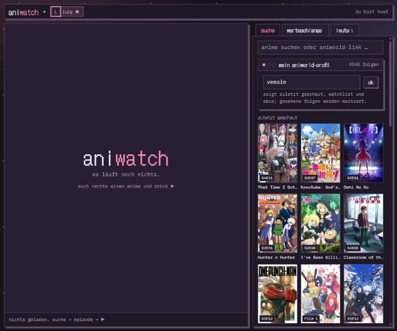

# aniwatch

<!-- cozy:cards -->
<div align="center">

<a href="https://github.com/vxnsin/aniwatch"><picture><source media="(prefers-color-scheme: dark)" srcset="https://raw.githubusercontent.com/vxnsin/aniwatch/output/repo-dark.svg?v=a62fec3193"></picture></a>

<a href="https://github.com/vxnsin/aniwatch#setup"><picture><source media="(prefers-color-scheme: dark)" srcset="https://raw.githubusercontent.com/vxnsin/aniwatch/output/nav-setup-dark.svg?v=e5aa186d8e"></picture></a><a href="https://github.com/vxnsin/aniplay"><picture><source media="(prefers-color-scheme: dark)" srcset="https://raw.githubusercontent.com/vxnsin/aniwatch/output/nav-aniplay-dark.svg?v=5ea8f2880f"></picture></a>

<a href="https://github.com/vxnsin/aniwatch/commits"><picture><source media="(prefers-color-scheme: dark)" srcset="https://raw.githubusercontent.com/vxnsin/aniwatch/output/commits-dark.svg?v=fec41c9469"></picture></a>

<a href="https://github.com/vxnsin/aniwatch/graphs/contributors"><picture><source media="(prefers-color-scheme: dark)" srcset="https://raw.githubusercontent.com/vxnsin/aniwatch/output/contributors-dark.svg?v=ca96f0abf0"></picture></a>

</div>
<!-- /cozy:cards -->

[](https://github.com/vxnsin/warden)

Watch anime together, right inside a Discord voice channel. aniwatch is a **Discord Activity**: whoever launches it becomes the host, everyone else watches in sync, queues up episodes and chats along. Episodes come from aniworld.to.

<p align="center"></p>

## Features

- **Host role:** Whoever opens the Activity first is the host and controls playback: start an episode, pause, seek, language, hoster, next episode. The host can hand the role over or turn on "everyone can control". If the host briefly reloads, the role stays reserved for them for 25 seconds.
- **Everyone in sync:** The server keeps the clock. Each client evens out small drift by adjusting playback speed and jumps on larger gaps. Late joiners land at the right spot straight away.
- **Queue:** Anyone can queue episodes or whole seasons and remove their own entries. When the queue is empty, autoplay continues with the next episode, even across seasons.
- **Search with autocomplete** as you type, or just paste an aniworld link.
- **AniWorld profile per person**, optional: recently watched, watchlist and subscriptions as quick picks, watched episodes get a checkmark.
- **Fullscreen** with a control bar that slides in and out. If Discord doesn't allow real fullscreen, the player fills the whole Activity window.
- **Loading indicator**, automatic **hoster switching** when a stream won't play, and muted autostart with an "unmute" button when the browser blocks sound without a click.
- Discord avatars of everyone present in the top bar, the host with a crown. Rich Presence shows "watching Solo Leveling · S1E01".
- In-room chat. Room, queue and progress survive a server restart (SQLite).

## Controls

| who | can |
|---|---|
| host | start an episode, play/pause, seek, language and hoster, next episode, stop, reorder and clear the queue, hand over host, "everyone can control" |
| everyone | search, queue, remove own entries, volume, fullscreen, resync, chat, own AniWorld profile |

Keyboard: `Space` play/pause, `←` `→` ±10 seconds, `f` fullscreen, `m` mute, `Esc` exit fullscreen.

## Setup

You need a Discord app, a machine that runs permanently (a Raspberry Pi is enough), and a domain that points to that machine over HTTPS. Discord only loads Activities from a fixed HTTPS address.

### 1. Create the Discord app

1. Create a new app at https://discord.com/developers/applications. [`.github/logo.png`](.github/logo.png) works as the icon.
2. **OAuth2:** Note the Client ID and Client Secret. Under "Redirects", add the placeholder `https://127.0.0.1`. Activities never redirect, but Discord requires a registered value for login.
3. **Activities → URL Mappings:** Prefix `/`, target your domain without `https://`, for example `aniwatch.example.org`. No other mappings are needed; streams, images and fonts all go through your own server.
4. **Activities → Settings:** Enable Activities and tick Web, iOS and Android.
5. **General Information:** Terms of Service `https://<your-domain>/terms`, Privacy Policy `https://<your-domain>/privacy`. The server ships both pages.
6. As long as the app isn't published, only people listed under "App Testers" can see it.

For the Activity assets, [`.github/cover.png`](.github/cover.png) and [`.github/background.png`](.github/background.png) are ready to use, both 1024 × 576.

### 2. Set up the server

On a Raspberry Pi or another Debian machine:

```bash
curl -fsSL https://raw.githubusercontent.com/vxnsin/aniwatch/main/scripts/setup-pi.sh | bash
```

The script asks for the repo, domain, folder, port, service name, and whether the DNS record at Vercel should automatically point to your home IP. Enter accepts the suggested value each time. It then:

- installs Node 22.13 or newer and [Caddy](https://caddyserver.com) if they're missing
- clones and builds the app, and puts the data in `/var/lib/aniwatch`
- creates a systemd service `aniwatch` that starts on boot
- adds its own Caddy block with an automatic HTTPS certificate, without touching other sites on the same machine
- optionally adds a cron job that keeps the A record at Vercel up to date

On the first run it asks for the Discord Client ID and Secret and writes both to `/etc/aniwatch.env`. To update later, just run the script again: it pulls the new version, builds and restarts. It also works without prompts:

```bash
DOMAIN=aniwatch.example.org bash ~/aniwatch/scripts/setup-pi.sh --yes
```

Ports 80 and 443 must be forwarded to the machine in your router. Test from outside: `https://<your-domain>/api/info` returns JSON.

If [werft](https://github.com/vxnsin/werft) is on the machine, it can take over the app part instead, so a later `werft update aniwatch` pulls, builds and restarts:

```bash
sudo werft install https://github.com/vxnsin/aniwatch
```

Caddy and the DNS record still come from the script above.

### 3. Launch

In Discord, join a voice channel, click the rocket icon "Activities" at the bottom, and aniwatch is listed there. Whoever launches it is the host.

## Local development

```bash
npm install
cp .env.example .env
npm run build
npm start
```

The `.env` contains `ALLOW_DEV=1`, which lets it run in the browser without Discord: `http://localhost:3100/?dev=1&name=luis&room=test`, and in a second tab with `name=mia`. For client changes use `npm run dev:client` (Vite with a proxy to the server). `aniwatch.state` is available in the browser console for inspection.

Client errors, such as blocked images or player and HLS errors, end up in the server log:

```bash
journalctl -u aniwatch -f
```

## Port from warden

If a [warden](https://github.com/vxnsin/warden) is running on the machine, aniwatch asks it for a port on startup instead of just taking `PORT`. `PORT` then becomes the preferred port: if it's free, it's used, otherwise warden assigns a different one and aniwatch tells you which on startup. The same name gets the same port on every start, `warden ls` shows who holds it, and it's released on shutdown. `npm run dev:client` asks warden as well and points its proxy at the port the server got. Without warden nothing changes. `warden run -- npm start` works too; warden then holds the port for the process.

| variable | default | |
|---|---|---|
| `WARDEN_URL` | `http://127.0.0.1:7010` | address of warden |
| `WARDEN_NAME` | `aniwatch` | name aniwatch registers under; the setup script fills in the service name |
| `WARDEN_TOKEN` | empty | token, if warden requires one |
| `WARDEN` | empty | `0` skips asking warden entirely |

## Structure

```
server/index.js    Express, Discord login, WebSocket per room, stream and image proxy
server/rooms.js    Room: host, queue, sync, autoplay, hoster fallback
server/db.js       SQLite (node:sqlite): users, sessions, room state, progress
server/warden.js   Port from warden, if one is running
lib/               aniworld scraper and one loader per hoster
client/            Vite app: discord.js (SDK), main.js (UI and player), style.css
client/public/     Fonts, icon, terms of service, privacy policy
scripts/setup-pi.sh  Setup on a Pi or server
```

Streams go through `/api/proxy` so the referer and user agent match what the hosters expect. Inside Discord only your own address is reachable, which is why fonts are local and covers are passed through `/api/img`.

## Hosters

| hoster | mode |
|---|---|
| VOE | HLS, MP4 as fallback |
| Vidmoly | HLS |
| Filemoon | HLS, iframe only on some domains |
| Vidoza, Streamtape | MP4 |
| Doodstream | iframe only, so no sync |

New hoster: add a file in `lib/loaders/` with `name`, `matches(url)` and `resolve(url)`; it's loaded automatically.

## Notes

- If you host aniwatch yourself, adapt `client/public/terms.html` and `client/public/privacy.html` to you as the operator.
- Content comes from aniworld.to and the respective hosters; aniwatch doesn't store any videos. Whether watching is legal where you are is your responsibility.
- Sister project for the living room, with the TV as player and the phone as remote: [aniplay](https://github.com/vxnsin/aniplay).

## License

MIT
